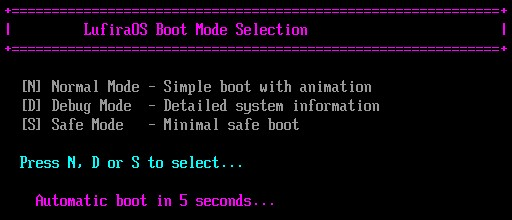
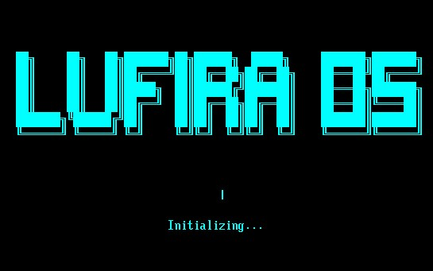
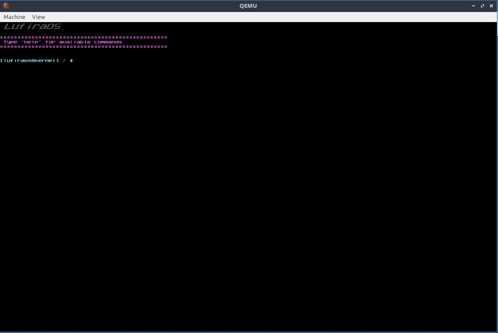
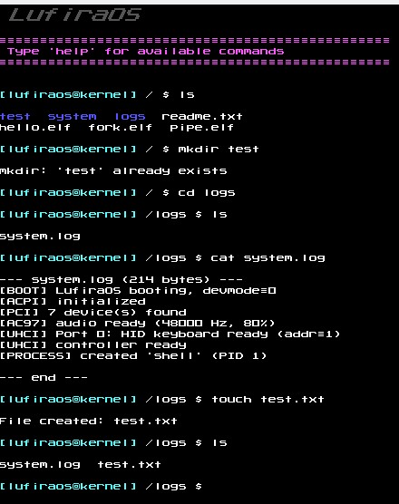
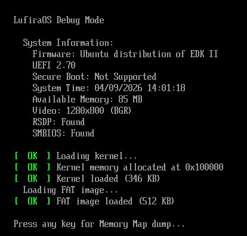
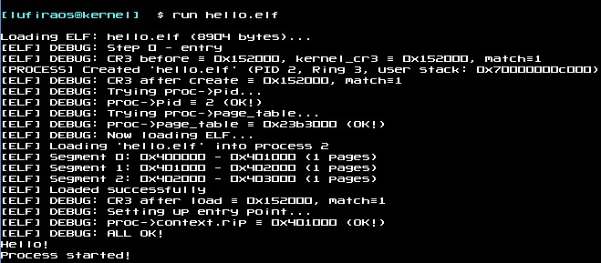
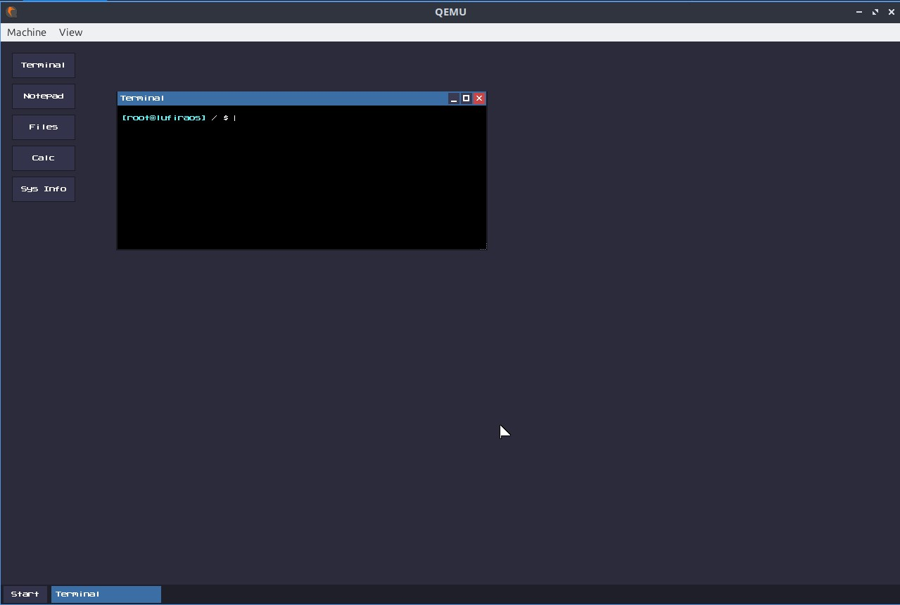

# LufiraOS


**LufiraOS** is a 64-bit hobby operating system for the x86_64 architecture, written from scratch in C and assembly by a single developer with some assistance from AI tools. It is designed to be educational, modular, and extensible, with a focus on understanding the core concepts of operating system development.

This repository is the kernel and UEFI bootloader. Everything that runs in userspace — the shell, coreutils, the package manager, the GUI and its apps — lives in a sibling repository, [lufira-packages](https://github.com/VLPLAY-Games/lufira-packages), built and staged onto a disk image by [LufiraOS-Builder](https://github.com/VLPLAY-Games/LufiraOS-Builder). Standalone syscall-level test programs live in [lufira-tests](https://github.com/VLPLAY-Games/lufira-tests).

# 🚨 VERSION 0.9.5 (ALPHA) 🚨

> ## ⚠️ IMPORTANT NOTICE
> ### This is a **PRE-ALPHA** hobby operating system.
> ### It contains **MANY BUGS**, incomplete features, and rough edges.
> ### It is **NOT** intended for production use or daily driving.
> ### The system is a work in progress, and many features are either partially implemented or not yet functional.
> ### Use at your own risk, and expect crashes, instability, and missing functionality.
> ### See [Known Issues and Limitations](#known-issues-and-limitations) for the most significant current problems.

# ⚠️ Documentation Notice

> This documentation is provided for LufiraOS v0.9.5 and may contain inaccuracies, outdated information, or minor inconsistencies with the current source code. LufiraOS is an actively developed project, and its architecture and implementation may change over time.
>If a discrepancy exists between this documentation and the source code, the source code should be considered the authoritative reference.
> Documentation will be continuously reviewed and updated as the project evolves. See [CHANGELOG.md](CHANGELOG.md) for a detailed history of changes.

## System Requirements

| Component | Minimum Requirement |
|-----------|---------------------|
| **Architecture** | x86_64 (64-bit) |
| **RAM** | 64 MB |
| **Disk Space** | 16 MB (fixed-size disk image: FAT12 ESP + LufiraFS region) |
| **Firmware** | UEFI, or legacy BIOS via `boot_legacy/` |
| **Disk controller** | ATA PIO, AHCI, or NVMe |
| **Display** | Any VESA/VBE-compatible framebuffer |
| **Audio (optional)** | AC'97 or Intel HDA compatible audio controller |
| **Network (optional)** | RTL8139, Intel e1000, or Intel e1000e compatible Ethernet, for the package manager and `wget`/`ping` |

**Note:** The system is developed primarily against QEMU; initial real-hardware boot testing has started but is **not yet reliable** — see [Known Issues](#known-issues-and-limitations) (AHCI hang on real SATA hardware).

---

## Screenshots

### Bootloader Menu



### Kernel Boot Process



### Interactive Shell



### Filesystem Operations



### Debug Mode



### Running ELF Programs



### GUI + Window Manager



## Table of Contents

1. [Overview](#overview)
2. [Screenshots](#screenshots)
3. [Features](#features)
4. [Architecture Overview](#architecture-overview)
5. [Getting Started](#getting-started)
   - [Prerequisites](#prerequisites)
   - [Building](#building)
   - [Running](#running)
6. [Documentation](#documentation)
7. [Project Structure](#project-structure)
8. [Known Issues and Limitations](#known-issues-and-limitations)
9. [Contributing](#contributing)
10. [License](#license)

---

## Overview

LufiraOS is a from-scratch operating system that boots via UEFI, features a graphical console and a userspace GUI, uses its own **LufiraFS** filesystem, and provides a preemptive multitasking environment with system calls, a minimal dynamically-linked C library, user accounts/permissions, USB (xHCI) input and mass storage, a real network stack (DNS/TCP/TLS/HTTPS), and a package manager. Essentially everything that can run in ring 3 — the shell, coreutils, the window manager, GUI apps, and, as of v0.9.5, **sound and networking themselves** — does; this repository's kernel binary ships only core subsystems and a privilege model (PCI device claims, port I/O, MMIO, DMA, IRQs) for the two privileged hardware daemons that now live in userspace instead.

### Key Concepts

- **Monolithic Kernel** – core services (memory management, process scheduling, drivers, filesystem, networking) run in kernel space; everything else is an ordinary userspace ELF.
- **UEFI Boot** – boots on modern hardware using the UEFI firmware.
- **Graphical Console** – framebuffer text output with a custom 8×8 font, 256-color palette, and a scaled/tilted big-text renderer for the boot logo; replaced by the GUI once a window manager registers.
- **Preemptive Multitasking** – the timer (100 Hz) preempts ring-3 code on a fixed timeslice, so a process that never yields can't stall the system; process states are READY, RUNNING, BLOCKED, SLEEPING, STOPPED, TERMINATED, with `fork()`/`exec()`/`wait()` and POSIX-style signals.
- **Virtual Memory** – `mmap()`/`munmap()` (anonymous, eager-allocated) back the minimal libc's `malloc()`.
- **ELF Executable Support** – loads and runs 64-bit ELF programs (ET_EXEC and ET_DYN) with real `argv`/`envp`; ET_DYN packages share one dynamically-linked `libc.so` instead of a static copy each.
- **System Calls** – 95 syscalls with user-pointer validation and errno-style error codes, covering files, processes, memory, users, USB, signals, a GUI/windowing surface, generic IPC, networking, and (v0.9.5) a PCI-device-claim privilege model for userspace drivers.
- **Mailbox IPC** – a generic per-process message mailbox (`SYS_IPC_SEND`/`RECV`), not GUI-specific; the window manager's own client protocol is built on top of it in userspace.
- **Users & Permissions** – Unix-like `uid`/`gid`/9-bit permission model with persistent accounts (`/etc/passwd`, `/etc/group`).
- **Package Manager** – `.lpg` packages, installed/updated/removed by `dlpg`, which can also sync and upgrade straight from a GitHub-hosted index over HTTPS.
- **Developer Mode** – a persistent on-disk flag that switches between a quiet boot (with a logo) and a fully verbose diagnostic log; see [`04_logging.md`](documentation/04_logging.md).

---

## Features

### Bootloader

- UEFI application with three boot modes:
  - **Normal** – animated splash screen, fast boot.
  - **Debug** – detailed system information, memory map dumps, table listings.
  - **Safe** – minimal mode for troubleshooting.
- Gathers system information (memory map, framebuffer, ACPI/SMBIOS).
- Loads the kernel and the raw disk image (FAT12 ESP + LufiraFS region — see `documentation/08_filesystem.md`).

### Kernel

- **Memory Management**
  - Physical Memory Manager (PMM) with bitmap allocation.
  - 4-level paging (PML4, PDPT, PD, PT) with 2 MiB huge pages for identity mapping.
  - Kernel heap (16 MiB) with first-fit allocator.

- **Interrupt Handling**
  - GDT, IDT, and TSS for protected mode and user-mode transitions.
  - PIC remapping (IRQs 0–15 → vectors 32–47).
  - Exception handling with register dumps.

- **Process Management**
  - ELF loader (ET_EXEC and ET_DYN, dynamic linking against a shared `libc.so`).
  - Process creation, scheduling, and termination, with real teardown (page tables, ring-0 stacks, and open file descriptors are freed on exit; orphaned background processes are reaped automatically).
  - **Preemptive** multitasking: the timer (100 Hz) preempts ring-3 code on a fixed timeslice; every process is guaranteed to actually reach ring 3, even one that never calls a syscall.
  - `fork()`, in-place `exec()` with real `argv`/`envp`, `wait()`, and POSIX-style signals (`SIGTERM`, `SIGKILL`, `SIGSTOP`, `SIGCONT`) via `kill`.
  - Anonymous pipes, and a generic per-process mailbox for message-based IPC (`SYS_IPC_SEND`/`RECV`).
  - `syscall` instruction for fast system calls.

- **Virtual Memory**
  - `mmap()`/`munmap()` — anonymous, eager-allocated, per-process region tracking, `PROT_READ`/`PROT_WRITE`/`PROT_EXEC` enforced via the NX bit. As of v0.9.5, a freed virtual-address range is reclaimed by a per-process free-list for reuse instead of a bump pointer that only ever grew.

- **System Calls (95 implemented)**
  - File operations: `open`, `close`, `read`, `write`, `seek`, `pipe`, `dup2`, `mkdir`, `rmdir`, `unlink`, `readdir`.
  - Process control: `exit`, `getpid`, `sleep`, `kill` (ownership-checked since v0.9.5), `yield`, `fork`, `exec`, `wait`, signals (`sigaction`, `sigreturn`, `alarm`), foreground tracking.
  - Memory: `mmap`, `munmap`.
  - Filesystem/identity: `getcwd`, `chdir`, `chmod`, `chown`, `getuid`, `getgid`, `statfs`.
  - Users/system: `su`, `mount`/`unmount`, `reboot`, `shutdown`, `devmode`, `useradd`, `groupadd`, `passwd`, `meminfo`, `cpuload`, `pslist`.
  - USB: device count/info/read/write — both read and write are root-only since v0.9.5.
  - GUI/windowing: window create/destroy/fill/draw/poll-event/move, framebuffer info/present/font, WM registration (root-only since v0.9.5), and (v0.9.5) a partial-dirty hint (`SYS_WIN_MARK_DIRTY`).
  - IPC: generic mailbox send/receive.
  - Networking: `SYS_NET_FETCH` — resolve, connect (TCP or TLS), send an HTTP(S) request, and return the parsed response body in one call; as of v0.9.5, also a streaming variant (`SYS_NET_FETCH_OPEN`/`_READ`/`_CLOSE`) and `SYS_PING`/`SYS_NET_CONFIG_*`, all relayed to a userspace network daemon.
  - **Userspace driver infrastructure (v0.9.5)** — a process must claim a specific PCI device (`SYS_DRIVER_CLAIM_DEVICE`/`_BY_CLASS`, root-only) before PCI config space, port I/O, MMIO (`SYS_MMAP_MMIO`), DMA (`SYS_DMA_ALLOC`), or IRQ (`SYS_IRQ_REGISTER`/`WAIT`) syscalls will touch it, and only within that device's own bounds; plus named shared memory (`SYS_SHM_CREATE`/`ATTACH`) for bulk IPC too large for the mailbox, and daemon-registration syscalls (`SYS_NETD_REGISTER`/`SYS_SOUNDD_REGISTER`) for the two privileged daemons below.
  - Every syscall that dereferences a user pointer validates it first; failures return errno-style codes (`EFAULT`, `EINVAL`, `ENOENT`, `ENOTDIR`, `ERANGE`, `EPERM`, `EACCES`, …) instead of a bare `-1`.

- **Minimal Userspace libc** (`libc/`)
  - `crt0.S` startup (`int main(int argc, char **argv, char **envp)`), thin syscall wrappers.
  - Dynamically linked as a shared `libc.so`, cached by the kernel after first load — packages no longer each carry a static copy.
  - Arena-based `malloc`/`free` built on `mmap`.
  - A `string.h` subset and a small `printf` (`%d %u %x %s %c %p %l*`).
  - `math.c` — the first libc source built with real FPU/XMM support (SysV `double`), needed by Doom's renderer; the rest of the libc stays on `-mgeneral-regs-only`.

- **Users, Groups & Permissions**
  - Unix-like `uid`/`gid`/9-bit permission model enforced on every file/directory operation; root (`uid` 0) bypasses all checks.
  - Persistent `/etc/passwd` and `/etc/group` (salted SHA-256 password hashing as of v0.9.5, up from unsalted 32-bit FNV-1a); `whoami`, `chmod`, `chown`, `useradd`, `groupadd`, `su`.
  - Boots straight into a root shell — no login prompt.

- **Filesystem — LufiraFS**
  - Custom filesystem (superblock, block bitmap, fixed inode table, real `.`/`..` directory entries, per-inode owner/group/permission bits) that replaces FAT as the primary storage backend.
  - A small FAT12 partition (the UEFI ESP) still holds only the bootloader and kernel binary, since UEFI firmware can only read FAT — everything else lives on LufiraFS.
  - Virtual Filesystem (VFS) abstraction layer; shell filesystem commands and syscalls go through the same `vfs_*_at()` call layer instead of duplicating LufiraFS logic.
  - Dirty block tracking and flushing back to disk.
  - Full path resolution (multi-level directories, per-process cwd) and directory operations (`mkdir`, `rm`, `opendir`, `readdir`).
  - Host-side `mkfs_lufirafs` tool for formatting/populating the disk image at build time.
  - **FAT driver** (`kernel/fs/fat/`) — `mount`/`unmount` a USB flash drive's FAT12/16/32 filesystem (read/write) under a path prefix (e.g. `/mnt/usb0`), wired straight into the VFS: ordinary `open`/`read`/`write`/`mkdir`/`unlink`/`readdir`/`cat`/`cp`/`ls`/`rm` work on it directly, no separate mount-specific commands needed. Root-directory-only per mount (no subdirectory traversal on the flash drive yet).
  - **ext2/ext4** (`kernel/fs/ext2/`), **exFAT** (`kernel/fs/exfat/`), and **RAMFS** (`kernel/fs/ramfs/`) drivers, alongside LufiraFS and FAT. Unlike FAT, exFAT mounts no longer read the whole device into RAM up front. FAT/exFAT/ext2 cluster/block/inode pointers read from disk are bounds-checked as of v0.9.5, closing an out-of-bounds read/write on a corrupted or crafted image.

- **Networking**
  - **As of v0.9.5, the entire stack runs in userspace** — `netd` (`lufira-packages/daemons/netd/`), a privileged daemon built on the PCI-device-claim syscalls above, not kernel code. `kernel/net/` no longer exists.
  - **Ethernet/ARP/IPv4/ICMP/TCP** — a polled (no interrupts) stack over RTL8139, Intel e1000, or Intel e1000e; TCP does stop-and-wait retransmission, a real advertised receive window (no congestion control), and, as of v0.9.5, a randomized initial sequence number and local port.
  - **DHCP** — automatic IP configuration, alongside the existing static-IP option.
  - **UDP + DNS** — a minimal resolver for turning hostnames into IPv4 addresses, with a randomized transaction ID and local port as of v0.9.5 (previously predictable).
  - **TLS 1.2, from scratch** — ECDHE key exchange over X25519, AES-128-GCM records, SNI, and RSA signature verification of the server's ServerKeyExchange against its own certificate. **No certificate chain / root CA validation** — see [Known Issues](#known-issues-and-limitations).
  - **An HTTP(S) client and `SYS_NET_FETCH` syscall** — one blocking call resolves, connects, requests, and returns a parsed response body to userspace; as of v0.9.5, also a streaming variant (`SYS_NET_FETCH_OPEN`/`_READ`/`_CLOSE`) that keeps the connection open across chunked reads. The package manager's `dlpg` subcommands are the main consumer.

- **Package Manager**
  - `.lpg` package format (header, dependency table, file table) and `dlpg` — install/update/list/remove, with dependency version checks and `/etc/packages/` bookkeeping. Up to 64 installed packages (`MAX_INSTALLED`).
  - `dlpg sync`/`dlpg upgrade` fetch the current package index and newer packages straight from a GitHub-hosted repository over HTTPS. As of v0.9.5, the actual `.lpg` download streams to disk in 128 KiB chunks instead of buffering the whole file in RAM — package size is no longer capped by a RAM buffer.
  - Each package in the index declares which kernel version(s) it needs; both `dlpg` and `LufiraOS-Builder` check this before installing/building.
  - See [lufira-packages](https://github.com/VLPLAY-Games/lufira-packages) for the actual package sources and the index.

- **GUI + Window Manager**
  - A generic mailbox IPC primitive plus a GUI syscall surface (window create/destroy/fill/draw/poll-event/move, framebuffer present) — the window manager itself is an ordinary userspace process, not kernel code, registered once via `SYS_WM_REGISTER` (root-only as of v0.9.5, closing a registration-hijack gap).
  - **Client-side dirty tracking (v0.9.5)** — a `dirty` flag on every widget (button/textbox/checkbox/listbox) plus `SYS_WIN_MARK_DIRTY`, a hint future client code can use to skip unnecessary redraws; purely advisory for now (`_draw()` still always redraws), with actual app migration left for v1.0.
  - Z-ordering, drag, resize/maximize/minimize, a taskbar with a Start menu (Exit GUI/Shutdown/Reboot), desktop launcher icons, dirty-rectangle compositing for responsive cursor movement — content updates (fill/draw-rect/draw-text) also track a dirty rectangle to scope the present step to the changed region, though this isn't fully reliable yet (see Known Issues).
  - **Fullscreen apps** — a launcher can hand `SYS_WM_REGISTER` to a child process (`fork()`, not `exec()` of the WM itself) and block until it exits, reclaiming the registration afterward. Used by **Doom** (a `doomgeneric` port, with sound).
  - GUI apps (terminal — wraps a real shell behind pipes, notepad, a file manager, a calculator, system info, Doom) in `lufira-packages`.

- **Drivers**
  - **Console** – graphical text output, 256-color palette, scrollback, scaled/tilted big-text rendering (boot logo, shell watermark).
  - **Disk** – ATA PIO (primary IDE channel), plus AHCI and NVMe controllers. `pci_config_read32`/`write32` run with interrupts disabled as of v0.9.5, a suspected contributor to intermittent NVMe/AHCI hangs.
  - **Keyboard (PS/2)** – scancode translation, modifiers, IRQ1.
  - **Mouse (PS/2)** – packet decoding, IRQ12.
  - **USB (xHCI)** – full command/event/transfer-ring host-controller driver, with a HID boot-protocol keyboard/mouse driver, USB Mass Storage (Bulk-Only Transport) support, and hotplug (device attach/detach after boot), unified with PS/2 through a common input dispatcher.
  - **PCI** – bus enumeration, BAR management.
  - **Userspace Driver Infrastructure (v0.9.5)** – `kernel/system/driver/`: a PCI-device-claim model (`SYS_DRIVER_CLAIM_DEVICE*`) plus port-I/O, MMIO, DMA, and IRQ syscalls, gated per claimed device instead of bare `uid == 0`. The foundation the next two items are built on.
  - **Network** – RTL8139, Intel e1000, and Intel e1000e Ethernet drivers, now living in the userspace `netd` daemon (v0.9.5) rather than the kernel.
  - **Audio** – AC'97 (mixer control, DMA playback) and Intel HDA (CORB/RIRB command rings), now living in the userspace `soundd` daemon (v0.9.5); HDA's player was rewritten around a continuous ring buffer the same release, fixing Doom's HDA audio being reduced to beeps.
  - **Serial (16550 UART)**, **HPET**, and **CMOS RTC** – alongside the PIT.

- **ACPI**
  - RSDP parsing (revision 1 and 2).
  - FADT detection and ACPI mode enabling.
  - System shutdown (S5 state).

- **Developer Mode & Logging**
  - Persistent on-disk flag (`/system/devmode.flag`) toggled with the `devmode` command, gating verbose boot/driver diagnostics.
  - Lightweight `klog` logger writes short status lines to `/logs/system.log` regardless of developer mode.

- **Shell** — now a real userspace process (`lufira-packages/shell/shell.c`), not kernel code
  - Line editing, command history, `cd`/`pwd`/`su`/`mount`/`unmount` builtins; everything else is `fork`+`exec`+`wait` against `/bin`.
  - File management, process control, users/permissions, USB mass storage, networking (`ifconfig`, `ping`, `wget`), the package manager (`dlpg`), and more — see [lufira-packages](https://github.com/VLPLAY-Games/lufira-packages) for the current command set.
  - Current working directory (cwd) is per-process, not shell-global.

---

## Architecture Overview

```svg

+--------------------------------------------------+
\| USER MODE |
\| +------------------------------------------+ |
\| | Shell / GUI / Packages (lufira-packages) | |
\| | netd / soundd (privileged driver daemons) | |
\| | (dynamically-linked ELF executables) | |
\| +------------------------------------------+ |
\| | |
\| syscall |
\| | |
+--------------------------------------------------+
\| KERNEL MODE |
\| +------------------------------------------+ |
\| | System Calls (95) | |
\| +------------------------------------------+ |
\| | VFS / LufiraFS Driver / Users&Perms | |
\| +------------------------------------------+ |
\| | GUI Syscalls (Win/FB) / Mailbox IPC / SHM | |
\| +------------------------------------------+ |
\| | Userspace Driver Infra (PCI claim, port | |
\| | I/O, MMIO, DMA, IRQ wait) -> netd/soundd | |
\| +------------------------------------------+ |
\| | Process Scheduler / ELF Loader | |
\| | (preemptive, fork / exec / wait / pipes) | |
\| +------------------------------------------+ |
\| | Memory Management (PMM / Paging / Heap / | |
\| | mmap with VA free-list) | |
\| +------------------------------------------+ |
\| | Drivers (Console, Disk/AHCI/NVMe, Keyboard, | |
\| | Mouse, USB/xHCI+MSD, PCI, Serial/HPET/RTC, | |
\| | ACPI) | |
\| +------------------------------------------+ |
\| | Devmode / klog | |
\| +------------------------------------------+ |
\| | CPU / Interrupts (GDT, IDT, IRQ, TSS) | |
\| +------------------------------------------+ |
\| | |
+----------------------+-----------------------------+
|
UEFI Bootloader
|
BootInfo Structure

````

**Note (v0.9.5):** the Ethernet/ARP/IP/ICMP/TCP/UDP/DNS/TLS 1.2/HTTP(S) stack and the AC'97/HDA audio drivers are no longer kernel code — they moved into `netd`/`soundd`, two privileged userspace daemons built on the new "Userspace Driver Infra" layer above, which is the only thing in the kernel that still knows about PCI/MMIO/port I/O for those devices.
---

## Getting Started

### Prerequisites

- **GCC** (x86_64-elf or with cross-compile support)
- **GNU ld**, **objcopy**, **nm**
- **GNU-EFI** headers and libraries (`/usr/include/efi`, `/usr/lib`)
- **dosfstools** (`mkfs.fat`)
- **mtools** (`mmd`, `mcopy`)
- **QEMU** with OVMF firmware
- **make**
- **Python 3**, for [LufiraOS-Builder](https://github.com/VLPLAY-Games/LufiraOS-Builder) (disk image assembly and running QEMU — see below)

### Building

This repository's own `Makefile` now builds only the kernel and bootloader:

```bash
git clone https://github.com/VLPLAY-Games/LufiraOS.git
cd LufiraOS
make kernel bootloader
````

Assembling a bootable disk image (staging the package manager's packages, the shell, etc.) and running it is [LufiraOS-Builder](https://github.com/VLPLAY-Games/LufiraOS-Builder)'s job — it needs nothing more than this repository checked out somewhere `LufiraOS-Builder` can find it:

```bash
git clone https://github.com/VLPLAY-Games/LufiraOS-Builder.git
cd LufiraOS-Builder
python3 build.py run   # builds this kernel too if needed, assembles disk.img, launches QEMU
```

### Running

`LufiraOS-Builder`'s `build.py` replaces the old all-in-one Makefile `run`/`debug`/`monitor` targets:

```bash
python3 build.py run       # quiet boot, boot logo, developer mode off
python3 build.py debug     # developer mode on, plus /tests and a USB stick
python3 build.py monitor   # same as run, with the QEMU HMP monitor (telnet on port 4444)
python3 build.py build     # just assemble disk.img, don't launch QEMU
python3 build.py clear     # remove all build output for a from-scratch rebuild
```

This repository's own `make clean` still removes just this repository's build artifacts (`kernel.bin`, `BOOTX64.EFI`, object files).

**QEMU Parameters** (as launched by `LufiraOS-Builder`):

- OVMF UEFI firmware (`/usr/share/ovmf/OVMF.fd`), or legacy BIOS boot
- Disk image as IDE, AHCI, or NVMe (`--disk-mode`, default `ide`)
- KVM acceleration when available (`-machine pc,accel=kvm:tcg`), software emulation otherwise
- 256 MB RAM, AC'97 or HDA audio (`--audio`, ALSA backend), RTL8139/e1000/e1000e NIC (`--net-device`) via QEMU user-mode networking
- Serial output redirected to stdio

The GUI (`gui.py`) exposes the same hardware choices as pickers instead of
CLI flags, plus (v0.9.5) a "Userspace drivers" section — `--driver NAME`/`--no-drivers` — picking whether `netd`/`soundd` themselves are even built onto the image, independent of the hardware choices above.

---

## Documentation

Detailed documentation is available in the `documentation/` directory:

| **File** | **Description** |
| -------------------------------------------------------------------------- | ----------------------------------------------------------- |
| [`01_bootloader.md`](documentation/01_bootloader.md)               | UEFI and legacy BIOS bootloaders, boot modes, BootInfo structure |
| [`02_kernel_init.md`](documentation/02_kernel_init.md)             | Kernel entry point and initialization order                 |
| [`03_bootinfo.md`](documentation/03_bootinfo.md)                   | BootInfo structure reference                                |
| [`04_logging.md`](documentation/04_logging.md)                     | Logging macros (log.h), developer mode, and `klog`          |
| [`05_build_system.md`](documentation/05_build_system.md)           | This repository's build (kernel + bootloader only) — see `LufiraOS-Builder` for image assembly/QEMU |
| [`06_libraries.md`](documentation/06_libraries.md)                 | System libraries (types, colors, string, etc.) and the shared `libc.so` |
| [`07_drivers.md`](documentation/07_drivers.md)                     | Device drivers (console, disk/AHCI/NVMe, keyboard, mouse, USB/xHCI + Mass Storage + hotplug, RTL8139/e1000/e1000e, PCI, AC'97/HDA, serial/HPET/RTC) |
| [`08_filesystem.md`](documentation/08_filesystem.md)               | LufiraFS, ext2/ext4, exFAT, RAMFS, VFS, FAT/USB mounting     |
| [`09_acpi.md`](documentation/09_acpi.md)                           | ACPI subsystem (RSDP, FADT, shutdown)                       |
| [`10_cpu_interrupts.md`](documentation/10_cpu_interrupts.md)       | CPU, GDT, IDT, IRQ, TSS, PIT, preemptive scheduling          |
| [`11_memory_management.md`](documentation/11_memory_management.md) | PMM, Paging, Heap, `mmap`/`munmap`                           |
| [`12_elf_processes.md`](documentation/12_elf_processes.md)         | ELF loader, dynamic linking, and process management          |
| [`13_syscalls.md`](documentation/13_syscalls.md)                   | All 95 system calls, by category                             |
| [`14_shell_commands.md`](documentation/14_shell_commands.md)       | The (now userspace) shell and its commands                   |
| [`15_users_permissions.md`](documentation/15_users_permissions.md) | Users, groups, and file permissions                          |
| [`16_networking.md`](documentation/16_networking.md)               | Network stack: Ethernet/ARP/IP/ICMP/TCP/UDP/DNS/DHCP/TLS 1.2/HTTP(S) |
| [`17_package_manager.md`](documentation/17_package_manager.md)     | `.lpg` format, `dlpg`, `sync`/`upgrade`                       |
| [`18_gui_wm.md`](documentation/18_gui_wm.md)                       | Mailbox IPC, the GUI syscall surface, the WM client protocol  |

---

## Project Structure

text

```
LufiraOS/
├── boot/                      # UEFI bootloader sources
│   ├── boot.c                 # Entry point, menu, countdown
│   ├── boot_modes/            # Boot mode implementations
│   │   ├── quick_boot.c       # Normal mode
│   │   ├── debug_boot.c       # Debug mode
│   │   └── safe_boot.c        # Safe mode
│   ├── loaders/               # Loaders
│   │   ├── kernel_loader.c    # Kernel loader
│   │   └── fat_loader.c       # FAT image loader
│   ├── system/                # System services
│   │   ├── memory.c           # Memory map
│   │   ├── graphics.c         # Graphics initialization
│   │   ├── tables.c           # ACPI/SMBIOS tables
│   │   └── exit_boot.c        # ExitBootServices
│   ├── ui/                    # UI utilities
│   │   ├── splash.c           # Splash screen
│   │   └── utils.c            # Console helpers
│   └── bootinfo.h             # BootInfo structure
│
├── boot_legacy/                # Legacy BIOS bootloader (stage1.asm/stage2.asm) — alternative to boot/
│
├── kernel/                    # Kernel sources
│   ├── kernel.c               # Entry point, initialization
│   ├── linker.ld              # Linker script
│   ├── drivers/               # Device drivers
│   │   ├── console/           # Console driver
│   │   ├── disk/              # ATA PIO, AHCI, and NVMe drivers
│   │   ├── keyboard/          # PS/2 keyboard driver
│   │   ├── mouse/             # PS/2 mouse driver
│   │   ├── usb/               # xHCI host controller + USB HID + Mass Storage driver, with hotplug
│   │   ├── serial/             # 16550 UART driver
│   │   ├── input/             # Shared PS/2 + USB HID input dispatcher (also feeds the WM)
│   │   └── pci/                # PCI bus driver
│   │                            # (net/ and sound/ moved to lufira-packages/daemons/ in v0.9.5)
│   ├── fs/                    # Filesystem
│   │   ├── lufirafs/          # LufiraFS driver (primary filesystem)
│   │   │   ├── lufirafs.c            # Core implementation
│   │   │   ├── lufirafs_vfs.c        # VFS wrapper
│   │   │   ├── lufirafs.h            # Driver API
│   │   │   └── lufirafs_format.h     # On-disk format (shared with mkfs_lufirafs)
│   │   ├── fat/                # FAT driver, used by mount/unmount for USB drives
│   │   ├── exfat/              # exFAT driver
│   │   ├── ext2/               # ext2/ext4 driver
│   │   ├── ramfs/              # RAMFS driver
│   │   └── vfs/                # Virtual Filesystem
│   │       ├── vfs.c          # VFS core
│   │       └── vfs.h          # VFS header
│   ├── lib/                   # System libraries
│   │   ├── types.h            # Basic types
│   │   ├── colors.h           # Color definitions
│   │   ├── string.c/h         # String utilities
│   │   ├── cpu.c/h            # CPU utilities
│   │   └── stdarg.h           # Variable arguments
│   ├── shell/                 # Legacy kernel-native shell (not used — see lufira-packages)
│   └── system/                # Kernel subsystems
│       ├── acpi/              # ACPI
│       ├── cpu/                # CPU management (GDT, IDT, IRQ, TSS)
│       ├── devmode/            # Developer-mode flag (persistent, gates DLOG)
│       ├── driver/              # (v0.9.5) Userspace-driver PCI claim/IRQ model
│       ├── klog/                # Persistent event logging (/logs/system.log)
│       ├── elf/                 # ELF loader + dynamic linking
│       ├── ipc/                 # Generic per-process mailbox IPC
│       ├── mm/                  # Memory management (PMM, Paging, Heap, mmap, shm)
│       ├── process/             # Process management (preemptive, fork/exec/signals)
│       ├── syscall/             # System calls (95), including the GUI/FB and driver-claim surface
│       ├── users/               # User/group database (/etc/passwd, /etc/group)
│       └── timer/               # PIT, HPET, and CMOS RTC; preemption timeslice
│
│   # (v0.9.5) kernel/net/, kernel/drivers/net/, and kernel/drivers/sound/ were removed —
│   # networking and audio now run as userspace daemons in lufira-packages/daemons/
│   # (netd/ — Ethernet/ARP/IP/ICMP/TCP/UDP/DNS/TLS/HTTP(S) + crypto/, and soundd.c)
│
├── libc/                      # Minimal userspace C library (built as a shared libc.so)
│   ├── crt0.S                 # Startup code (_start -> main(argc, argv, envp))
│   ├── include/                # lufira/syscall.h, string.h, stdlib.h, stdio.h
│   └── src/                   # malloc.c, printf.c, string.c
│
├── tools/                     # Host-side build tools
│   ├── mkfs_lufirafs.c        # LufiraFS formatting/populating tool
│   ├── lpg_format.h           # .lpg package format (shared with lufira-packages)
│   └── seed/                  # Seeded /etc/passwd, /etc/group content
│
├── build/                     # Build artefacts (created by make) — kernel.bin/BOOTX64.EFI only;
│                               # disk.img is assembled by LufiraOS-Builder, not this repository
│
├── Makefile                   # Build system (kernel + bootloader only)
├── README.md                  # This file
├── CHANGELOG.md               # Version history
└── documentation/             # Documentation
    ├── 01_bootloader.md
    ├── 02_kernel_init.md
    └── ...
```

---

## Known Issues and Limitations

- **Real-hardware AHCI hang.** On at least one real laptop, boot hangs shortly after the "using AHCI, SATA mode enabled" log line. Not yet root-caused — possibly related to booting off a USB stick rather than the laptop's internal disk (untested: whether the hang is AHCI-specific or a more general real-hardware boot-path issue). Planned for v1.0 (a settle-delay/COMRESET after enabling AHCI is the leading hypothesis, needs verification on real hardware).
- **Real hardware support is early and largely untested beyond the AHCI issue above.** The system is developed and tested primarily in QEMU; UEFI/ACPI/USB quirks on real firmware are mostly unknown. v1.0 adds systematic real-hardware testing and a proper disk installer.
- **TLS has no certificate chain validation.** The from-scratch TLS 1.2 client verifies the server actually controls the key in the certificate it presents, but does not check that certificate against any trusted root CA — fine against a naive on-path attacker, not against one who can present their own certificate. No hardware RNG either (mitigated but not solved for TCP ISN/DNS by v0.9.5's `netrand`), so no real forward secrecy. See `documentation/16_networking.md`.
- **`mount` of a FAT drive reads the whole USB device into RAM up front** (capped at 8 MB; exFAT mounts no longer do this) — no lazy/streaming FAT access, and only the root directory of a mounted drive is reachable (no subdirectory traversal yet) — see [`08_filesystem.md`](documentation/08_filesystem.md).
- **WM dirty-rectangle partial repaint is not fully reliable.** Content updates are supposed to present only the changed region instead of the whole screen, but interacting with some programs still behaves like a full redraw — not resolved, under investigation. (v0.9.5 added a client-side `dirty` flag and `SYS_WIN_MARK_DIRTY` as groundwork for a future fix, not a fix itself.)
- **GUI memory usage grows with repeated open/close of programs**, more noticeably when resizing windows — looks like a leak somewhere in the WM or window-buffer lifecycle, not yet root-caused.
- **NVMe disk mode is occasionally flaky** — boot sometimes stalls around USB controller initialization, or the system hangs at a random later point; intermittent, looks like a race condition specific to NVMe, not yet root-caused.
- **No memory protection beyond paging permissions and mmap's own bookkeeping.** `mmap` is anonymous-only and eagerly allocated; as of v0.9.5 freed address ranges are reclaimed by a free-list, but there is still no copy-on-write or demand paging.
- **No setuid/setgid, no multi-group membership, and no password KDF work factor.** The users/permissions model is a straightforward `uid`/`gid`/9-bit implementation — passwords are salted SHA-256 as of v0.9.5 (up from unsalted FNV-1a), but SHA-256 alone has no deliberate slowdown like bcrypt/argon2 — see [`15_users_permissions.md`](documentation/15_users_permissions.md).
- See [CHANGELOG.md](CHANGELOG.md) for issues fixed in past versions.

---

## Contributing

Contributions are welcome! Here are some areas for improvement:

- **Filesystem**: Long file name (LFN) support, additional filesystem drivers (ext2, ISO9660), LufiraFS indirect-block-chain growth beyond a single indirect block, subdirectory traversal on a mounted USB drive (currently root-directory-only).
- **Drivers**: graphics acceleration, multi-block USB Mass Storage transfers, the real-hardware AHCI boot hang (see [Known Issues](#known-issues-and-limitations)).
- **Networking**: TLS certificate chain/root-CA validation, a real entropy source, TCP congestion control.
- **Processes**: Copy-on-write address spaces, demand-paged `mmap`.
- **Security**: setuid/setgid, cryptographically sound password hashing, VFS-level permission enforcement (currently caller-enforced, not VFS-enforced).
- **Shell**: Redirection, environment variables, scripting (see `lufira-packages`).
- **GUI**: More widgets, window-position persistence across sessions, additional apps (see `lufira-packages`).
- **Documentation**: More examples, tutorials, API references.

### Guidelines

1. Follow the existing code style (K&R with 4-space indentation).
2. Keep functions modular; comment the non-obvious *why*, not the obvious *what*.
3. Update documentation when adding new features.
4. Test changes in QEMU before submitting.

---

## License

This project is licensed under the GPL-3.0 License. See the [LICENSE](LICENSE) file for details.

---

---

**LufiraOS** – Building an OS from scratch, one commit at a time.
